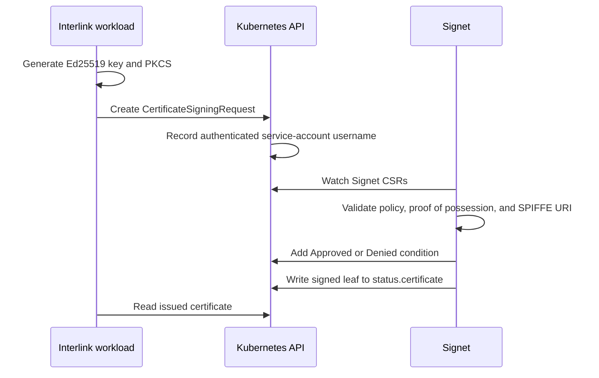

# Signet

Signet is a narrow, CRD-free X.509-SVID issuer built specifically for Interlink workloads on Kubernetes. It watches the built-in `certificates.k8s.io/v1` `CertificateSigningRequest` API, derives one SPIFFE identity from the authenticated Kubernetes service account, approves requests that satisfy the fixed profile, and writes a directly signed leaf certificate to CSR status.

Signet is not a general-purpose PKI, cert-manager replacement, admission webhook, or network certificate service.

## Security model

A request is accepted only when all of these facts agree:

- `spec.signerName` is Signet's configured custom signer.
- The API-server-populated username is `system:serviceaccount:<namespace>:<name>` and that service account is explicitly allowlisted.
- `spec.usages` is exactly `digital signature`, `server auth`, and `client auth`.
- `spec.expirationSeconds` is between 600 seconds and the configured maximum.
- `spec.request` is one RFC 7468 `CERTIFICATE REQUEST` containing canonical PKCS #10 v1 DER with a valid Ed25519 proof-of-possession signature.
- The request has an empty subject and exactly one URI SAN.
- The URI is exactly `spiffe://<trust-domain>/ns/<namespace>/sa/<name>`, derived from the authenticated username rather than trusted from the CSR.

Every mismatch is denied with a stable reason code. Signet never copies a requested subject, DNS name, IP address, email address, CA bit, arbitrary extension, or arbitrary lifetime into a certificate.

The online signing CA is intentionally simple: a persistent Ed25519 key in one Kubernetes Secret. Protect that Secret with Kubernetes encryption at rest, tightly limit API access, and keep a protected offline backup. A compromised Signet pod or CA Secret can issue credentials within the CA's trust domain. Signet does not provide HSM integration, revocation, or automatic CA rotation.

The supplied Deployment runs one replica deliberately. Multiple uncoordinated replicas could sign the same newly observed CSR before either status update becomes visible. Kubernetes restarts the single replica, and rolling updates use a surge pod, but there is no leader election.

See [RFC_PROFILE.md](RFC_PROFILE.md) for the complete certificate, request, and signer contract. The profile is backed by archived RFC Editor source texts and checksums in [`rfcs/`](rfcs/).

## Request flow



Signet exposes only `/healthz` and `/readyz` for kubelet probes. Certificate operations use the Kubernetes API; there is no Signet service endpoint.

## Certificate profile

The root and leaf profiles are fixed rather than configurable:

| Property | Signing CA | Interlink leaf |
| --- | --- | --- |
| Key and signature | Ed25519 | Ed25519 |
| Subject | Configured non-empty common name | Empty |
| SAN | None | One critical SPIFFE URI |
| Basic constraints | Critical, `cA=TRUE`, `pathLen=0` | Critical, `cA=FALSE` |
| Key usage | Critical `keyCertSign`, `cRLSign` | Critical `digitalSignature` |
| Extended key usage | None | `serverAuth`, `clientAuth` |
| Serial | Positive, non-zero, at most 20 octets | Positive, non-zero, at most 20 octets |
| Chain | Self-signed trust anchor | Directly signed by the configured trust anchor |
| Leaf lifetime | Not applicable | Exact requested interval, at most 24 hours by default, with a five-minute `notBefore` backdate |

Interlink currently transports one certificate, so Signet emits a directly signed leaf rather than a leaf-plus-intermediate chain. The trust anchor is distributed separately and is never placed in CSR status.

## Minimal deployment

Prerequisites: Kubernetes v1.22 or later, `kubectl` with Kustomize support, and an image built from this repository.

1. Build and publish the container, or replace the image in `deploy/signet.yaml` with an immutable image digest:

   ```sh
   docker build -t ghcr.io/alexandernicholson/signet:0.1.0 .
   docker push ghcr.io/alexandernicholson/signet:0.1.0
   ```

2. Generate the persistent CA locally. The command refuses to overwrite any existing output:

   ```sh
   cargo run --release -- bootstrap \
     --output-dir deploy/ca \
     --common-name "Interlink production root" \
     --validity-days 3650
   ```

   `deploy/ca/` is gitignored. Back up `ca.key` securely before deployment.

3. Edit `deploy/signet.yaml`:

   - Set `SIGNET_TRUST_DOMAIN`.
   - Set the exact comma-separated `SIGNET_ALLOW_SERVICE_ACCOUNTS` allowlist.
   - Set `SIGNET_SIGNER_NAME` if the default is not suitable.
   - If the signer name changes, update the ClusterRole `signers.resourceNames` entry to the same value. Kubernetes checks the virtual `approve` and `sign` verbs against that exact signer.
   - Pin `image` to the digest you published.

4. Review the rendered objects, then apply them:

   ```sh
   kubectl kustomize deploy > /tmp/signet-rendered.yaml
   kubectl apply -k deploy
   kubectl -n signet-system rollout status deployment/signet
   kubectl -n signet-system get pods
   ```

5. Distribute the public trust bundle to the namespace that runs Interlink. ConfigMaps cannot be mounted across namespaces; the generated `signet-system/interlink-trust-bundle` is a source copy, not an automatic workload mount. For a workload in `workloads`:

   ```sh
   kubectl -n workloads create configmap interlink-trust-bundle \
     --from-file=ca-bundle.pem=deploy/ca/bundle.pem \
     --dry-run=client -o yaml | kubectl apply -f -
   ```

   Mount that ConfigMap and configure Interlink to trust `ca-bundle.pem`. Never mount `ca.key` into a workload pod.

6. Confirm the controller is ready and inspect CSR outcomes:

   ```sh
   kubectl -n signet-system get deployment signet
   kubectl get certificatesigningrequests
   kubectl describe certificatesigningrequest <name>
   ```

The manifest grants only cluster-wide CSR read access, approval/status mutation, and signer-scoped `approve`/`sign` authorization. The CA volume is group-readable only by the non-root Signet process.

## Configuration

`signet run` accepts flags or matching environment variables:

| Setting | Default | Meaning |
| --- | --- | --- |
| `SIGNET_CA_CERTIFICATE` | `/var/run/signet-ca/ca.crt` | Signing CA certificate PEM |
| `SIGNET_CA_PRIVATE_KEY` | `/var/run/signet-ca/ca.key` | Matching PKCS #8 Ed25519 private key PEM |
| `SIGNET_SIGNER_NAME` | `example.com/signet` | Custom Kubernetes signer name |
| `SIGNET_TRUST_DOMAIN` | Required | SPIFFE trust domain |
| `SIGNET_ALLOW_SERVICE_ACCOUNTS` | Required | Comma-separated `<namespace>:<name>` allowlist |
| `SIGNET_MAX_TTL_SECONDS` | `86400` | Maximum requested certificate interval |
| `SIGNET_HEALTH_ADDRESS` | `0.0.0.0:8080` | Probe listener |

Readiness remains false until the initial Kubernetes CSR watch has completed. Liveness reports immediately after the probe listener starts.

## Development

```sh
cargo fmt --all -- --check
cargo clippy --all-targets --all-features -- -D warnings
cargo test --all-targets
cargo llvm-cov --all-targets --fail-under-lines 100
```

The coverage gate enforces 100% source-line coverage. Tests exercise the RFC profile, malformed and adversarial CSRs, CA persistence and validation, Kubernetes subresource patches, watch lifecycle, graceful shutdown, health behavior, CLI failures, deployment resource generation, and rollback after partial writes.

For reproducible hot-path commands and measured optimization rounds, see [BENCHMARKS.md](BENCHMARKS.md).

## References

- [Kubernetes Certificates and Certificate Signing Requests](https://kubernetes.io/docs/reference/access-authn-authz/certificate-signing-requests/)
- [RFC 2986: PKCS #10](https://www.rfc-editor.org/rfc/rfc2986)
- [RFC 3986: URI syntax](https://www.rfc-editor.org/rfc/rfc3986)
- [RFC 5280 and RFC 6818: Internet X.509 PKI](https://www.rfc-editor.org/rfc/rfc5280)
- [RFC 5958: Asymmetric Key Packages](https://www.rfc-editor.org/rfc/rfc5958)
- [RFC 7468: PKIX textual encodings](https://www.rfc-editor.org/rfc/rfc7468)
- [RFC 8410: Ed25519 in PKIX](https://www.rfc-editor.org/rfc/rfc8410)

## License

MIT
